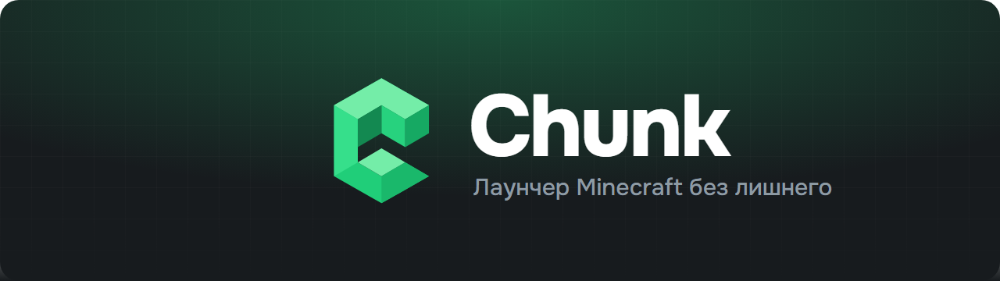
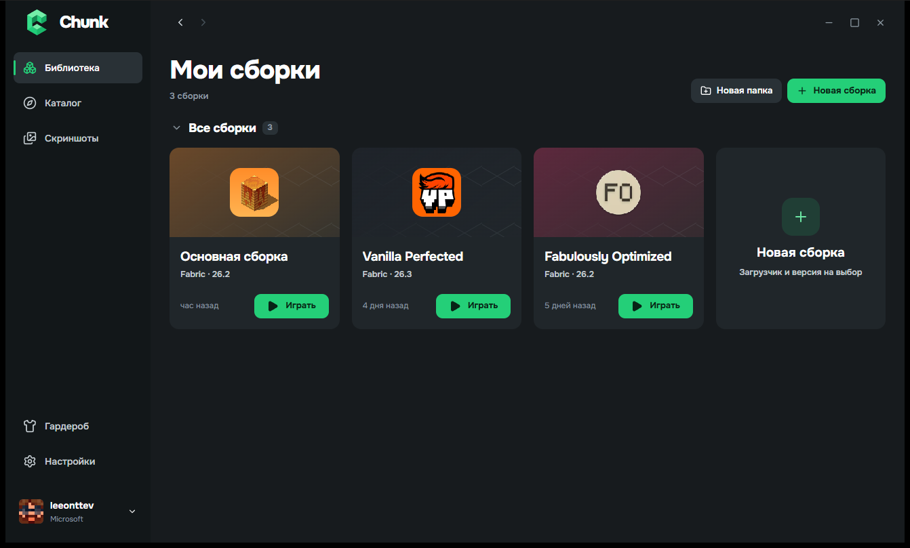
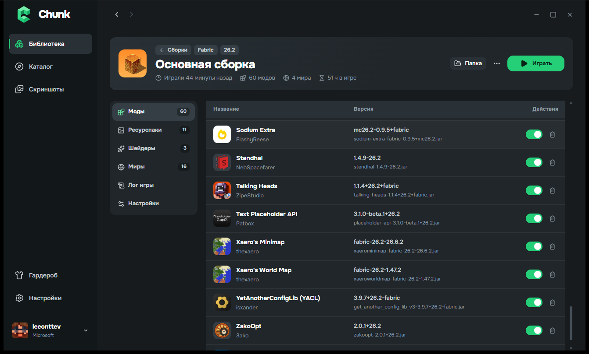

<p align="center">
	
</p>

<p align="center">
	<a href="https://github.com/Leeonttev/Chunk/releases/latest"></a>
	<a href="https://github.com/Leeonttev/Chunk/releases"></a>
	
	<a href="COPYING.md"></a>
</p>

<p align="center">
	<b>Chunk</b> — быстрый и красивый лаунчер Minecraft на русском языке.<br>
	Моды, шейдеры, ресурспаки и готовые сборки с Modrinth в пару кликов. Без рекламы и слежки.
</p>

<p align="center">
	<a href="https://github.com/Leeonttev/Chunk/releases/latest/download/Chunk-Setup.exe"><b>⬇ Скачать Chunk для Windows</b></a>
</p>

---

## Возможности

- **Каталог Modrinth внутри лаунчера.** Моды, ресурспаки, шейдеры и целые сборки: поиск, фильтры по версии и загрузчику, установка одной кнопкой.
- **Чужие сборки становятся вашими.** Ставите сборку автора и меняете в ней что угодно, а когда автор выпустит обновление — обновляетесь, не теряя своих модов.
- **Автофикс.** Если после обновления модов игра не запускается, Chunk найдёт причину и предложит исправление: обновить Fabric/Quilt Loader, поставить нужную Java или выключить мешающие моды. Ничего не меняется без вашего согласия.
- **Обновление модов пачкой.** «Обновить всё» одной операцией, с прогрессом и возможностью отменить.
- **Вход без лицензии и через Microsoft.** Играйте по нику или с аккаунтом Microsoft, несколько аккаунтов одновременно.
- **Гардероб.** Свои скины, примерка в 3D, классическая и тонкая модель рук.
- **Скриншоты всех сборок в одном месте** с просмотром в полном качестве.
- **Статус в Discord** — друзья видят, во что вы играете.
- **Сам обновляется.** Новые версии Chunk приходят автоматически.

## Скриншоты

<p align="center">
	
	
</p>

## Установка

1. [Скачайте **Chunk-Setup.exe**](https://github.com/Leeonttev/Chunk/releases/latest/download/Chunk-Setup.exe) — это всегда последняя версия.
2. Запустите файл и нажмите «Установить».
3. Если Windows покажет «Windows защитила ваш компьютер», нажмите **«Подробнее» → «Выполнить в любом случае»**. Это предупреждение появляется у всех программ без платной цифровой подписи.

Права администратора не нужны. Удалить Chunk можно через «Параметры → Приложения».

## Для разработчиков

Нужны [Node.js](https://nodejs.org/), [pnpm](https://pnpm.io/), [Rust](https://www.rust-lang.org/tools/install) и [зависимости Tauri](https://v2.tauri.app/start/prerequisites/).

```bash
pnpm install
pnpm app:dev
```

| Часть                     | Папка               |
| ------------------------- | ------------------- |
| Интерфейс лаунчера (Vue)  | `apps/chunk`        |
| Оболочка приложения       | `apps/app`          |
| Ядро (Rust)               | `packages/app-lib`  |
| Установщик                | `apps/installer`    |

Выпуск новой версии: поднимите версию в `apps/chunk/package.json` и запустите

```bash
node scripts/release-chunk.mjs "Что нового в этой версии"
```

Скрипт соберёт подписанное обновление и установщик в `dist/release-<версия>/` — эти файлы загружаются в новый выпуск на GitHub.

## Лицензия и благодарности

Chunk основан на открытом исходном коде [Modrinth App](https://github.com/modrinth/code) и распространяется на условиях **GNU GPL-3.0**. Подробности — в [COPYING.md](COPYING.md).

Chunk — независимый проект и не связан с Modrinth и Rinth, Inc. Каталог модов предоставляется сервисом [Modrinth](https://modrinth.com). Minecraft — товарный знак Mojang Studios; Chunk не связан с Mojang и Microsoft.
